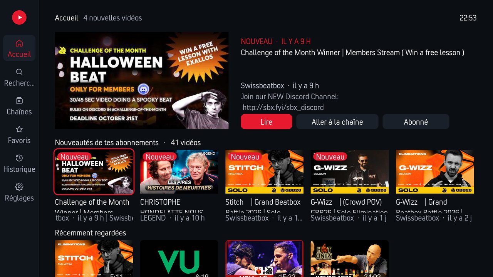
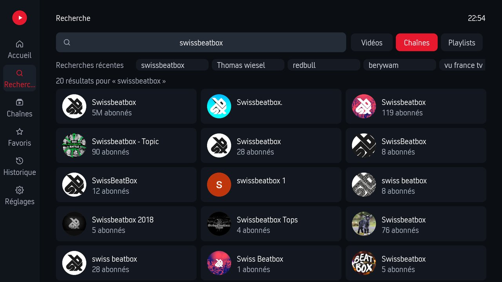
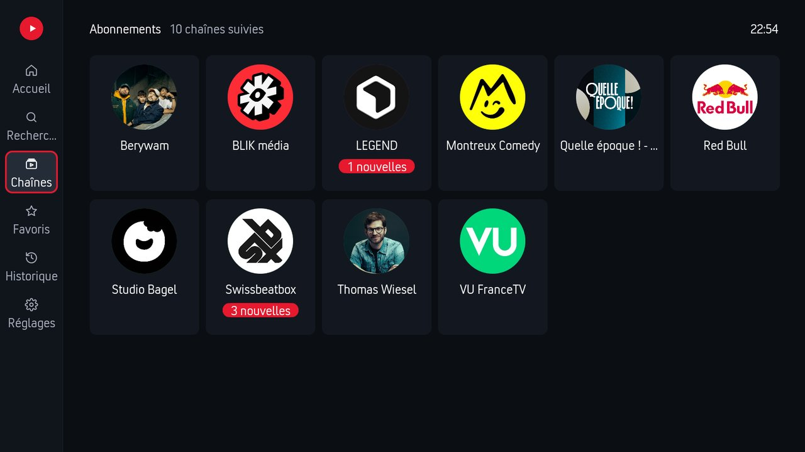
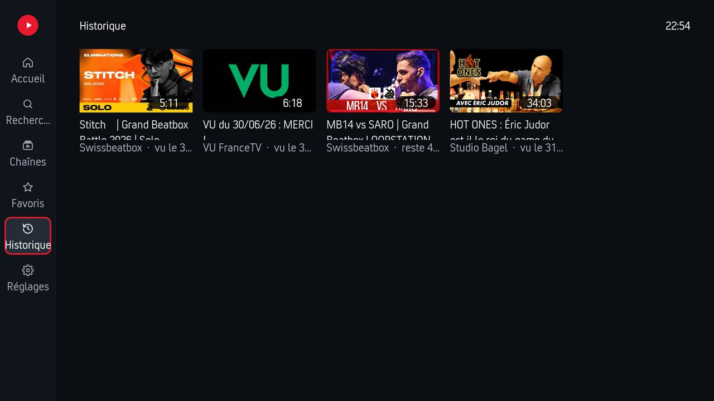
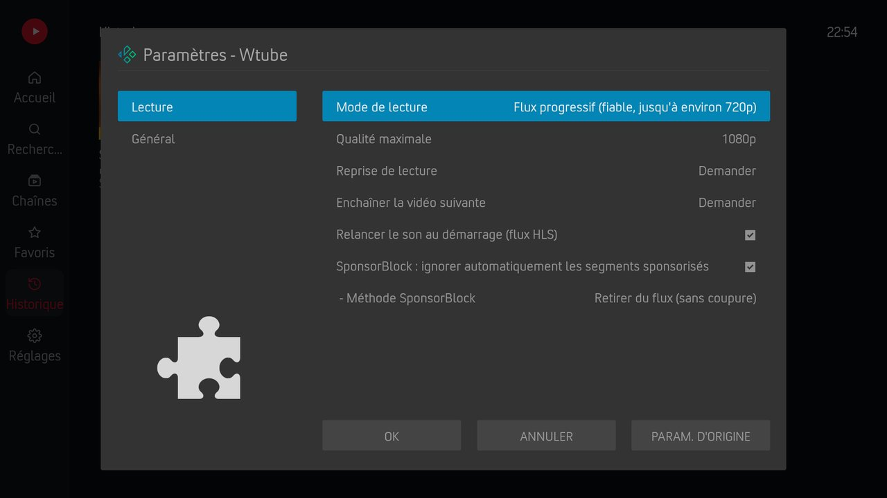
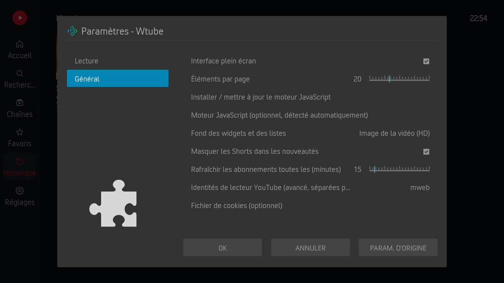

**Français** · [English](readme.en.md)

# Wtube — YouTube pour Kodi

<!-- version:auto -->
**Version : 0.6.7**
<!-- /version:auto -->

Module Kodi pour regarder **YouTube sans compte et sans clé d'API Google**, avec une interface
plein écran en français. Il s'inspire de **NewPipe / PipePipe** : l'extraction se fait sur
l'appareil avec [yt-dlp](https://github.com/yt-dlp/yt-dlp), les abonnements et l'historique
restent **en local**, et les passages sponsorisés sont retirés grâce à
[SponsorBlock](https://sponsor.ajay.app).

> Projet indépendant, sans lien avec YouTube ni Google. YouTube est une marque de Google LLC.

## Captures d'écran



| Recherche | Chaînes suivies |
|:---:|:---:|
|  |  |
| **Historique** | **Réglages — Lecture** |
|  |  |

<details><summary>Réglages — Général</summary>



</details>

## Installation

**Recommandé — dépôt TheWorms** (mises à jour automatiques).

Télécharge le dépôt en cliquant **[ICI](https://raw.githubusercontent.com/TheWorms/kodi-repo/main/zips/repository.theworms/repository.theworms.zip)**, puis dans Kodi :

1. **Add-ons** → **Installer depuis un fichier zip** → sélectionne le zip téléchargé
   *(si Kodi bloque, active **Sources inconnues** dans Système → Add-ons)*
2. **Installer depuis un dépôt** → **TheWorms Repository** → **Extensions vidéo** → **Wtube**
3. Les mises à jour seront ensuite automatiques

Au premier lancement, ouvre **Programmes → Moteur JavaScript** (installé avec l'addon) pour
télécharger le moteur dont YouTube a besoin. L'addon le propose aussi de lui-même la
première fois qu'une vidéo est bloquée.

**Installation manuelle (alternative) :** télécharge le zip de l'addon depuis la page [Releases](../../releases), puis **Add-ons** → **Installer depuis un fichier zip**. Installe aussi [Moteur JavaScript](https://github.com/TheWorms/kodi-addon-jsruntime), dont il dépend.

## Fonctionnalités

- **Interface plein écran** — accueil avec vidéo à la une, nouveautés des abonnements et
  vidéos récentes ; recherche (vidéos, chaînes, playlists) ; pages chaîne avec bannière,
  onglets Vidéos / Playlists ; favoris ; historique.
- **Abonnements sans compte** — stockés sur l'appareil ; nouveautés lues dans les flux RSS
  publics des chaînes, rafraîchies en arrière-plan. Shorts masquables.
- **SponsorBlock sans coupure** — un relais HLS local retire les segments sponsorisés du flux
  avant la lecture (méthode « saut » disponible en repli).
- **Reprise de lecture** — « Reprendre à … / Lire depuis le début » au lancement (ou toujours /
  jamais), barres de progression sur les vignettes.
- **Enchaînement** — à la fin d'une vidéo, la suivante de la liste (écran, widget, chaîne,
  playlist) démarre, avec ou sans question (réglable).
- **Tout lire** — depuis le menu d'une vidéo : toute la liste ou à partir de cette vidéo
  (chaîne, favoris, recherche…), Suivant / Précédent pour passer d'une vidéo à l'autre.
- **Menu contextuel** — lire ensuite, file d'attente, favoris, aller à la chaîne,
  s'abonner, marquer comme vue, lire toute une playlist.
- **Widgets pour l'accueil du skin** — nouveautés, une vidéo par chaîne, à reprendre,
  récemment regardées, favoris, mes chaînes, et un widget par chaîne ou par recherche
  (*Extensions vidéo → Wtube → Widgets* dans le sélecteur de widgets du skin).
- **Menu classique** — toujours disponible (réglage « Interface plein écran »).

## Dépendances

| Addon | Rôle |
|-------|------|
| `script.module.jsruntime` | Moteur JavaScript (Deno / Node.js) pour les défis de YouTube — **obligatoire** |
| `script.module.requests` | Requêtes HTTP |
| `inputstream.adaptive` | Lecture HLS (recommandé) |

yt-dlp et son solveur `yt-dlp-ejs` sont **embarqués** dans l'addon (`resources/lib/vendor/`),
ajoutés au moment du build à partir de [`vendor.txt`](vendor.txt).

## Données et vie privée

Aucun compte, aucune télémétrie. Abonnements, historique, favoris et positions de reprise sont
dans `addon_data/plugin.video.wtube/wtube.db`. Les seules requêtes sortantes vont vers YouTube
(pages et flux), SponsorBlock (préfixe de hash, la vidéo exacte n'est pas transmise) et, une
fois, le téléchargement du moteur JavaScript.

## Structure du dépôt

```
addon.xml
main.py                 entrée plugin (menus, widgets, lecture)
script.py               entrée directe de l'interface (RunScript, favoris, menus du skin)
service.py              relais HLS SponsorBlock + rafraîchissement du flux
vendor.txt              paquets Python embarqués au build (yt-dlp, yt-dlp-ejs)
resources/
├── settings.xml
├── language/           traductions gettext (fr_FR, en_GB)
├── lib/                code de l'addon (extracteur, interface, widgets, relais…)
└── skins/Default/      fenêtre plein écran 1080i et textures
```

## Développement

```
pip install --target resources/lib/vendor -r vendor.txt   # yt-dlp en local, hors git
```

Le dossier `resources/lib/vendor/` est ignoré par git ; le générateur du dépôt Kodi le
reconstruit à chaque release avec les dernières versions.

## Localisation

```
resources/language/resource.language.fr_fr/strings.po
resources/language/resource.language.en_gb/strings.po
```

## Crédits

- **Développement :** [TheWorms](https://github.com/TheWorms).
- **Extraction :** [yt-dlp](https://github.com/yt-dlp/yt-dlp) et
  [yt-dlp-ejs](https://github.com/yt-dlp/ejs) (Unlicense).
- **Segments sponsorisés :** données [SponsorBlock](https://sponsor.ajay.app)
  (CC BY-NC-SA 4.0).
- **Inspiration :** [NewPipe](https://newpipe.net) et PipePipe.

## Licence

GPL v3 ou ultérieure — voir [`LICENSE.txt`](LICENSE.txt).
