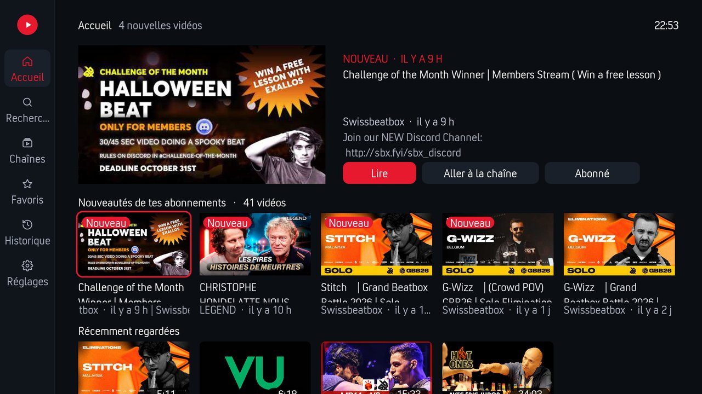
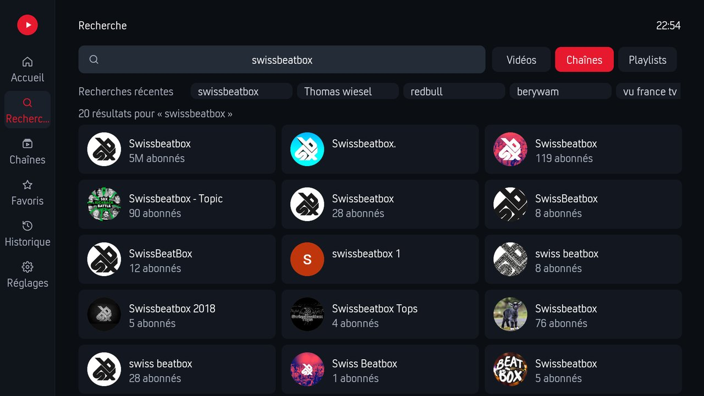
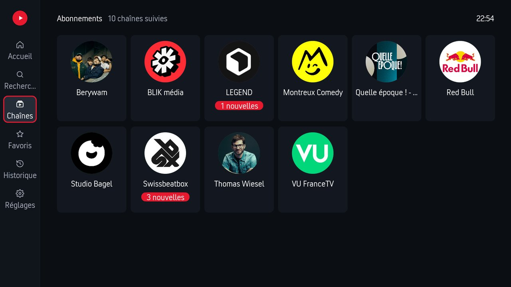
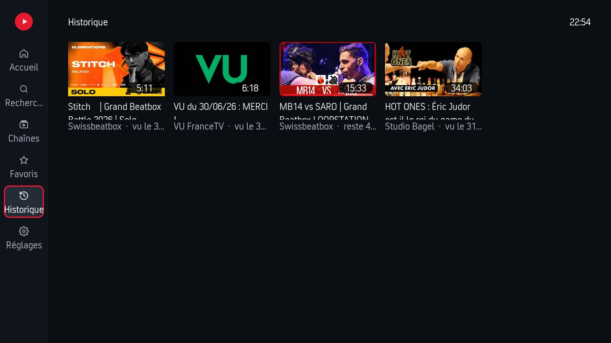
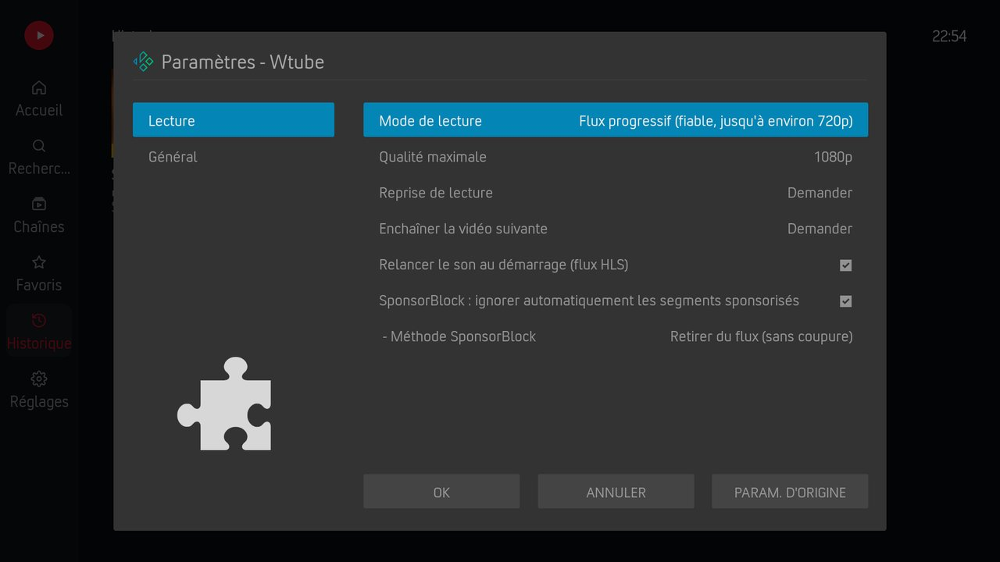
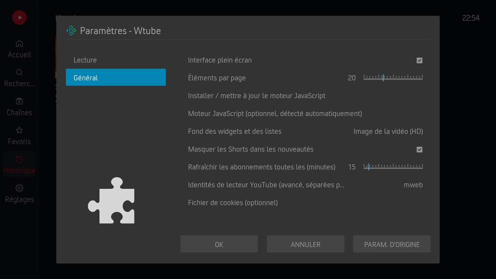

[Français](README.md) · **English**

# Wtube — YouTube for Kodi

<!-- version:auto -->
**Version : 0.6.7**
<!-- /version:auto -->

Kodi add-on to watch **YouTube without an account or a Google API key**, with a full-screen
interface. Inspired by **NewPipe / PipePipe**: extraction runs on the device with
[yt-dlp](https://github.com/yt-dlp/yt-dlp), subscriptions and history stay **local**, and
sponsored segments are removed thanks to [SponsorBlock](https://sponsor.ajay.app).

> Independent project, not affiliated with YouTube or Google. YouTube is a trademark of Google LLC.

## Screenshots



| Search | Followed channels |
|:---:|:---:|
|  |  |
| **History** | **Settings — Playback** |
|  |  |

<details><summary>Settings — General</summary>



</details>

## Installation

**Recommended — TheWorms repository** (automatic updates).

Download the repository by clicking **[HERE](https://raw.githubusercontent.com/TheWorms/kodi-repo/main/zips/repository.theworms/repository.theworms.zip)**, then in Kodi:

1. **Add-ons** → **Install from zip file** → select the downloaded zip
   *(if Kodi blocks it, enable **Unknown sources** under Settings → Add-ons)*
2. **Install from repository** → **TheWorms Repository** → **Video add-ons** → **Wtube**
3. Updates will then be automatic

On first use, open **Programs → JavaScript engine** (installed with the add-on) to download the
engine YouTube requires. The add-on also offers it the first time a video is blocked.

**Manual install (alternative):** download the add-on zip from the [Releases](../../releases) page, then **Add-ons** → **Install from zip file**. Also install [JavaScript engine](https://github.com/TheWorms/kodi-addon-jsruntime), which it depends on.

## Features

- **Full-screen interface** — home with a featured video, new videos from subscriptions and
  recently watched; search (videos, channels, playlists); channel pages with banner and
  Videos / Playlists tabs; favourites; history.
- **Subscriptions without an account** — stored on the device; new videos read from the
  channels' public RSS feeds, refreshed in the background. Shorts can be hidden.
- **Seamless SponsorBlock** — a local HLS relay removes sponsored segments from the stream
  before playback (skip method available as a fallback).
- **Resume playback** — "Resume from … / Play from the beginning" on start (or always /
  never), progress bars on thumbnails.
- **Autoplay** — when a video ends, the next one from the same list (screen, widget, channel,
  playlist) starts, with or without a prompt (configurable).
- **Play all** — from a video's menu: the whole list or from that video on (channel,
  favourites, search…), Next / Previous to move between videos.
- **Context menu** — play next, queue, favourites, go to channel, subscribe, mark as
  watched, play a whole playlist.
- **Skin home widgets** — new videos, one video per channel, continue watching, recently
  watched, favourites, my channels, plus one widget per channel or per search
  (*Video add-ons → Wtube → Widgets* in the skin's widget picker).
- **Classic menus** — still available ("Full-screen interface" setting).

## Dependencies

| Add-on | Purpose |
|--------|---------|
| `script.module.jsruntime` | JavaScript engine (Deno / Node.js) for YouTube's challenges — **required** |
| `script.module.requests` | HTTP requests |
| `inputstream.adaptive` | HLS playback (recommended) |

yt-dlp and its `yt-dlp-ejs` solver are **bundled** in the add-on (`resources/lib/vendor/`),
added at build time from [`vendor.txt`](vendor.txt).

## Data and privacy

No account, no telemetry. Subscriptions, history, favourites and resume points live in
`addon_data/plugin.video.wtube/wtube.db`. The only outgoing requests go to YouTube (pages and
feeds), SponsorBlock (hash prefix — the exact video is not sent) and, once, the JavaScript
engine download.

## Repository layout

```
addon.xml
main.py                 plugin entry (menus, widgets, playback)
script.py               direct entry to the interface (RunScript, favourites, skin menus)
service.py              SponsorBlock HLS relay + feed refresh
vendor.txt              Python packages bundled at build time (yt-dlp, yt-dlp-ejs)
resources/
├── settings.xml
├── language/           gettext translations (fr_FR, en_GB)
├── lib/                add-on code (extractor, interface, widgets, relay…)
└── skins/Default/      1080i full-screen window and textures
```

## Development

```
pip install --target resources/lib/vendor -r vendor.txt   # local yt-dlp, outside git
```

`resources/lib/vendor/` is ignored by git; the Kodi repository generator rebuilds it with the
latest versions on every release.

## Localization

```
resources/language/resource.language.fr_fr/strings.po
resources/language/resource.language.en_gb/strings.po
```

## Credits

- **Development:** [TheWorms](https://github.com/TheWorms).
- **Extraction:** [yt-dlp](https://github.com/yt-dlp/yt-dlp) and
  [yt-dlp-ejs](https://github.com/yt-dlp/ejs) (Unlicense).
- **Sponsored segments:** [SponsorBlock](https://sponsor.ajay.app) data (CC BY-NC-SA 4.0).
- **Inspiration:** [NewPipe](https://newpipe.net) and PipePipe.

## License

GPL v3 or later — see [`LICENSE.txt`](LICENSE.txt).
